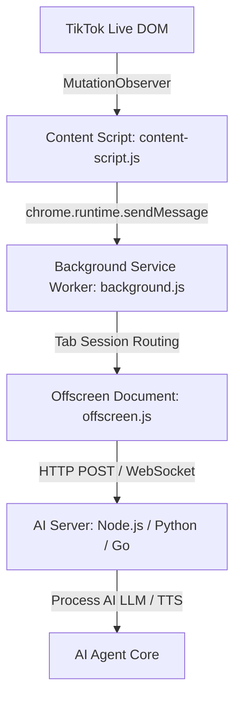

# Hướng Dẫn Tích Hợp & Gửi Câu Hỏi Đến Server AI (TikTok Live Chat Extension)

Tài liệu này hướng dẫn chi tiết cơ chế hoạt động, luồng truyền dữ liệu, cấu trúc payload và cách xây dựng Server AI (Node.js / Python) để tiếp nhận và xử lý các câu hỏi/bình luận trực tiếp từ Extension TikTok Live.

---

## 1. Kiến Trúc Luồng Dữ Liệu (End-to-End Architecture)

Dữ liệu bình luận từ phòng Live TikTok được thu thập và chuyển tiếp tới Server AI qua mô hình 4 tầng:



### Chi tiết nhiệm vụ từng thành phần:

1. **Content Script (`content-script.js`)**:
   - Theo dõi DOM cây chat TikTok Live bằng `MutationObserver`.
   - Trích xuất thông tin: Tên hiển thị (`nickname`), ID người dùng (`username`), nội dung câu hỏi (`message`), ảnh đại diện (`profilePic`).
   - Đính kèm định danh kịch bản/bot AI (`ai_reply_id`) và `tabId` theo tab hiện tại.
2. **Service Worker (`background.js`)**:
   - Quản lý cấu hình session đa tab (`tab_sessions`) và cấu hình kết nối (`connection_settings`).
   - Tự động khởi tạo và điều phối **Offscreen Document**.
3. **Offscreen Document (`offscreen/offscreen.js`)**:
   - Chịu trách nhiệm thiết lập kết nối mạng trực tiếp tới Server AI qua **HTTP POST** hoặc **WebSocket**.
   - **FIFO Queue Buffer (Max 100)**: Tự động lưu trữ tin nhắn vào hàng đợi nếu Server AI bị mất kết nối hoặc chập chờn.
   - **Tự động phục hồi (Auto-Reconnect)**: Thử kết nối lại mỗi 5 giây khi server online trở lại và tự động xả hàng đợi (`flushBuffer`) gửi tuần tự các câu hỏi đang chờ.
4. **Server AI Backend**:
   - Tiếp nhận câu hỏi, phân loại theo `ai_reply_id`, nạp prompt và gọi mô hình AI (Gemini, ChatGPT, Claude hoặc Local LLM) để phản hồi hoặc điều khiển Streamer ảo (Holo/TTS).

---

## 2. Cấu Hình Kết Nối Extension (Connection Settings)

Bạn có thể tùy chỉnh thông số kết nối trực tiếp trong giao diện Popup của Extension:

* **Protocol (Giao thức)**: `http` (HTTP REST API) hoặc `ws` (WebSocket)
* **Host**: `127.0.0.1` hoặc IP server
* **Port**: `3003` (hoặc cổng bất kỳ của Server AI)
* **Path**: `/api/chat/tiktok-comment`
* **AI Reply ID**: Mã định danh cấu hình bot AI (ví dụ: `sales_bot_01`, `livestream_ai_host`)

**URL mặc định:**
* HTTP: `http://127.0.0.1:3003/api/chat/tiktok-comment`
* WebSocket: `ws://127.0.0.1:3003/api/chat/tiktok-comment`

---

## 3. Cấu Trúc Payload (JSON Schema)

Dữ liệu gửi từ Extension đến Server AI có cấu trúc JSON như sau:

### Bảng định nghĩa trường dữ liệu:

| Trường (Field) | Kiểu | Bắt buộc | Mô tả | Ví dụ |
| :--- | :--- | :---: | :--- | :--- |
| `nickname` | `string` | Có | Tên hiển thị của khán giả TikTok | `"Nguyễn Văn A"` |
| `username` | `string` | Có | Handle TikTok (bắt đầu bằng `@`) | `"@nguyen.vana"` |
| `message` | `string` | Có | Nội dung câu hỏi / bình luận | `"Shop ơi áo này có size L không?"` |
| `profilePic` | `string` | Không | Link ảnh đại diện khán giả | `"https://p16-sign-va.tiktokcdn.com/..."` |
| `timestamp` | `number` | Có | Unix Timestamp (mili-giây) | `1784534400000` |
| `ai_reply_id` | `string` | Có | ID kịch bản / Persona AI của tab này | `"bot_ban_hang_fashion"` |
| `tabId` | `number` | Không | ID tab của trình duyệt đang bắt live | `21424354` |

### Ví dụ Payload JSON:

```json
{
  "nickname": "Nguyễn Văn A",
  "username": "@nguyen.vana",
  "message": "Shop ơi áo sơ mi màu trắng còn size XL không, bao nhiêu tiền vậy?",
  "profilePic": "https://p16-sign-va.tiktokcdn.com/tos-useast2a-avt-0068/sample.jpeg",
  "timestamp": 1784534400000,
  "ai_reply_id": "bot_ban_hang_fashion",
  "tabId": 12845
}
```

---

## 4. Code Mẫu Xây Dựng AI Server Tiếp Nhận

### Cách 1: Node.js / Express Server (Khuyên Dùng cho Hệ Thống HTTP REST)

```javascript
// server.js
const express = require('express');
const cors = require('cors');

const app = express();
const PORT = 3003;

app.use(cors());
app.use(express.json());

// Endpoint tiếp nhận câu hỏi từ TikTok Extension
app.post('/api/chat/tiktok-comment', async (req, res) => {
  try {
    const { nickname, username, message, profilePic, timestamp, ai_reply_id, tabId } = req.body;

    console.log(`\n📩 [Nhận câu hỏi từ TikTok]`);
    console.log(`👤 Người gửi: ${nickname} (${username})`);
    console.log(`💬 Nội dung: "${message}"`);
    console.log(`🤖 AI Target ID: ${ai_reply_id}`);

    // Phản hồi 200 OK ngay cho Extension để hoàn tất chuyển giao
    res.status(200).json({ status: 'success', message: 'Comment received' });

    // Đưa vào quy trình AI xử lý bất đồng bộ (LLM + TTS)
    processQuestionWithAI({ nickname, username, message, ai_reply_id });
  } catch (error) {
    console.error('Lỗi tiếp nhận comment:', error);
    res.status(500).json({ status: 'error', message: error.message });
  }
});

async function processQuestionWithAI(data) {
  // TODO: Tích hợp gọi Google Gemini / OpenAI / DeepSeek API
  // Ví dụ:
  // const reply = await callLLM(data.message, data.ai_reply_id);
  // await triggerTTS(reply);
}

app.listen(PORT, () => {
  console.log(`🚀 AI Server đang chạy tại http://127.0.0.1:${PORT}`);
  console.log(`👉 Endpoint TikTok Chat: http://127.0.0.1:${PORT}/api/chat/tiktok-comment`);
});
```

---

### Cách 2: Python / FastAPI Server (Hỗ trợ cả HTTP POST & WebSocket)

```python
# main.py
from fastapi import FastAPI, WebSocket, WebSocketDisconnect
from pydantic import BaseModel
from typing import Optional
import uvicorn

app = FastAPI(title="TikTok Live AI Relay Server")

class TikTokComment(BaseModel):
    nickname: str
    username: str
    message: str
    profilePic: Optional[str] = ""
    timestamp: int
    ai_reply_id: Optional[str] = "default"
    tabId: Optional[int] = None

# 1. Endpoint HTTP POST
@app.post("/api/chat/tiktok-comment")
async def receive_tiktok_comment(payload: TikTokComment):
    print(f"\n📩 [HTTP] Nhận câu hỏi từ {payload.nickname}: {payload.message}")
    print(f"🤖 Kịch bản AI: {payload.ai_reply_id}")
    
    # Kích hoạt tiến trình trả lời câu hỏi AI (async task)
    # await handle_ai_response(payload)
    
    return {"status": "success", "received": payload.message}

# 2. Endpoint WebSocket (Nhanh và độ trễ thấp)
@app.websocket("/api/chat/tiktok-comment")
async def websocket_endpoint(websocket: WebSocket):
    await websocket.accept()
    print("🔌 Extension đã kết nối qua WebSocket!")
    try:
        while True:
            data = await websocket.receive_json()
            print(f"\n⚡ [WS] Nhận tin nhắn: {data.get('nickname')}: {data.get('message')}")
            # Xử lý câu hỏi với AI
    except WebSocketDisconnect:
        print("❌ Extension đã ngắt kết nối WebSocket.")

if __name__ == "__main__":
    uvicorn.run("main:app", host="127.0.0.1", port=3003, reload=True)
```

---

## 5. Các Điểm Cần Lưu Ý Khi Triển Khai (Best Practices)

1. **Phản hồi HTTP 200 nhanh chóng**:
   - Khi nhận HTTP POST, server nên phản hồi ngay status `200 OK` để Extension biết tin nhắn đã tới nơi an toàn.
   - Việc sinh câu trả lời AI (LLM) và tạo giọng đọc (TTS) nên đưa vào hàng đợi nền (Queue / Asynchronous Worker) để không làm block kết nối.
2. **Cơ chế lọc trùng lặp**:
   - Extension đã có gắn `data-ext-parsed` trên DOM, tuy nhiên Server AI cũng nên kiểm tra bộ đệm ngắn hạn dựa trên `(username, message, timestamp)` để loại trừ trùng lặp trong trường hợp tab reload.
3. **Phân luồng theo `ai_reply_id`**:
   - Bạn có thể chạy đồng thời nhiều phòng Live TikTok trên các tab khác nhau, mỗi tab cấu hình một `ai_reply_id` riêng biệt (ví dụ: Tab 1 bán mỹ phẩm -> `cosmetics_bot`, Tab 2 bán thời trang -> `fashion_bot`). Server AI sẽ dựa vào trường này để chọn đúng bộ System Prompt & Knowledge Base phù hợp.
