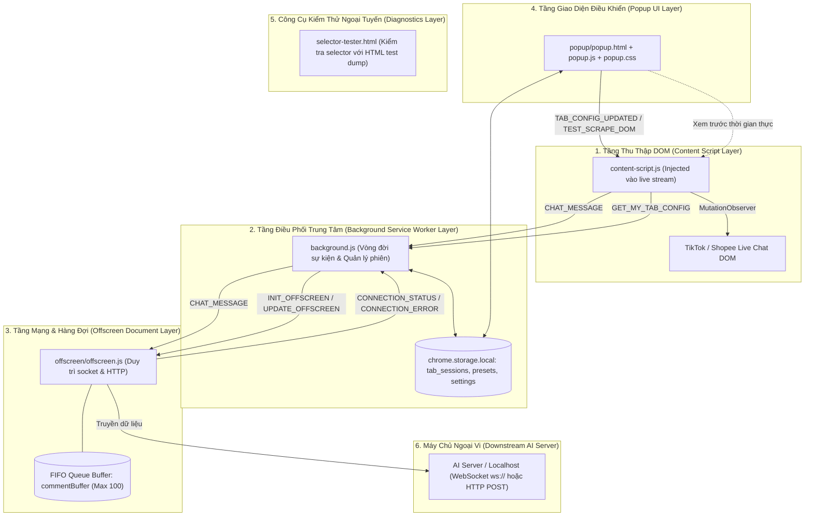

# Tài Liệu Tri Thức Dự Án LIVE Relayer (OpenSpec Project Knowledge Base)

## 1. Bối Cảnh Dự Án (Project Context)
* **Tên dự án**: LIVE Relayer (TikTok & Shopee Live Chat Relayer Extension)
* **Phiên bản hiện tại**: `2.0.1` (Manifest V3)
* **Mục tiêu cốt lõi**: Tự động cào và trích xuất các bình luận trực tiếp theo thời gian thực từ các trang phát trực tiếp (TikTok Live, Shopee Live), đóng gói thông tin định danh và nội dung, sau đó chuyển tiếp (relay) đến máy chủ xử lý trí tuệ nhân tạo (Server AI Agent / LLM / TTS / Livestream ảo) qua giao thức WebSocket hoặc HTTP POST.
* **Quyền hạn trình duyệt (Permissions)**: `storage`, `activeTab`, `offscreen`, `tabs`, `host_permissions: ["<all_urls>"]`.

---

## 2. Công Nghệ và Ngăn Xếp Kỹ Thuật (Technology Stack)

| Lớp (Layer) | Công Nghệ Sử Dụng | Vai Trò và Vị Trí Trong Mã Nguồn |
| :--- | :--- | :--- |
| **Nền tảng** | Google Chrome Extension (Manifest V3) | Chuẩn tiện ích mở rộng hiện đại, không dùng persistent background page |
| **Ngôn ngữ** | Vanilla JavaScript (ES6+), HTML5, CSS3 | Toàn bộ mã nguồn chạy native, không qua đóng gói (No Webpack/Vite/Babel) |
| **Quản lý gói / Thư viện** | Không có (`No node_modules`, `No package.json`) | Dự án thuần Web APIs và Chrome Extension APIs |
| **DOM Scraping** | `MutationObserver` API | Lắng nghe DOM thời gian thực trong `content-script.js` |
| **Mạng & Chuyển tiếp** | `WebSocket` API & `fetch` API | Chạy trong ngữ cảnh Offscreen Document (`offscreen/offscreen.js`) |
| **Lưu trữ cục bộ** | `chrome.storage.local` | Quản lý phiên đa tab, bộ chọn và cấu hình kết nối |
| **Đa tiến trình ngầm** | `chrome.offscreen` API | Tạo tài liệu DOM ảo để duy trì kết nối mạng và hàng đợi FIFO |
| **Điều phối thông điệp** | `chrome.runtime` & `chrome.tabs` messaging | Giao tiếp nội bộ giữa Content Script, Background, Offscreen và Popup |
| **Tích hợp ngoại vi** | Local/Remote AI Server & GitHub Raw | Giao tiếp với AI Server cục bộ và cập nhật selector từ GitHub |

---

## 3. Kiến Trúc 4 Tầng và Phân Hệ Chính (Architecture & Subsystems)

Hệ thống được thiết kế theo mô hình 4 tầng độc lập để khắc phục giới hạn Service Worker bị ngắt kết nối trong Manifest V3:



### Chi Tiết Từng Phân Hệ:
1. **Content Script (`content-script.js`)**:
   - Tiêm vào các trang livestream.
   - Dùng `MutationObserver` để quét phần tử con trong vùng chứa chat (`chatContainer`).
   - Đánh dấu `data-ext-parsed="true"` trên mỗi nút bình luận để loại trừ trùng lặp.
   - Chạy vòng lặp định kỳ (2000ms) để tự động gắn lại observer nếu khung chat bị DOM virtualized tái tạo lại.
2. **Background Service Worker (`background.js`)**:
   - Lắng nghe `chrome.runtime.onInstalled` để khởi tạo cấu hình và preset mặc định từ `selectors.json`.
   - Giám sát trạng thái cào của các tab (`isAnyTabMonitoring()`) để bật/tắt `chrome.offscreen.createDocument` hoặc `closeDocument`.
   - Lắng nghe `chrome.tabs.onRemoved` để giải phóng bản ghi phiên khi người dùng đóng tab.
   - Làm cầu nối chuyển tiếp thông điệp `CHAT_MESSAGE` từ Content Script sang Offscreen Document.
3. **Offscreen Document (`offscreen/offscreen.js`)**:
   - Môi trường DOM ẩn giúp chạy WebSocket bền bỉ hoặc gửi HTTP POST mà không bị Chrome Service Worker đóng luồng.
   - Triển khai bộ đệm FIFO tối đa 100 tin nhắn khi mạng mất kết nối hoặc máy chủ tạm dừng.
   - Tự động thăm dò kết nối lại mỗi 5 giây (`handleDisconnect`).
   - Xả hàng đợi tuần tự (`flushBuffer`) khi máy chủ hoạt động trở lại.
4. **Popup Dashboard (`popup/popup.js`, `popup/popup.html`)**:
   - Bảng điều khiển người dùng: Bật/tắt cào dữ liệu theo tab (`monitoring-toggle`).
   - Cấu hình thông số mạng (`Protocol`, `Host`, `Port`, `Path`, `AI Auto-Reply ID`).
   - Lựa chọn Preset nền tảng (TikTok Live, Shopee SH, Shopee Live) hoặc nạp tệp JSON tùy biến.
   - Đồng bộ online bộ chọn từ GitHub raw URL.
   - Kiểm thử kết nối mạng (`Test Connection`) và kiểm thử cào DOM (`Test Scraper`).
   - Bảng chẩn đoán kỹ thuật (System Diagnostics) và luồng xem trước 20 bình luận trực tiếp.
5. **Selector Tester Tool (`selector-tester.html`)**:
   - Trang HTML độc lập giúp kiểm thử và tinh chỉnh CSS selector trên các file HTML dump (nằm trong thư mục `htmltest/`).

---

## 4. Cấu Trúc Thư Mục Kho Lưu Trữ (Repository Structure)

```
EXTENSION_CHAT/
├── manifest.json              # Khai báo cấu hình Chrome Extension Manifest V3
├── background.js              # Background Service Worker (điều phối vòng đời, đa tab, offscreen)
├── content-script.js          # Content Script cào DOM trên trang livestream
├── selectors.json             # Cấu hình bộ chọn CSS mặc định (TikTok, Shopee SH, Shopee Live)
├── selector-tester.html       # Công cụ kiểm thử selector ngoại tuyến trên trình duyệt
├── .gitignore                 # Cấu hình loại trừ Git
│
├── offscreen/                 # Tài liệu Offscreen Context
│   ├── offscreen.html         # Khung HTML nạp offscreen script
│   └── offscreen.js           # Bộ xử lý kết nối WebSocket / HTTP POST và hàng đợi FIFO
│
├── popup/                     # Giao diện người dùng trên thanh công cụ
│   ├── popup.html             # Cấu trúc HTML của Popup Dashboard
│   ├── popup.css              # Giao diện chủ đạo màu tối (Dark theme), biến CSS
│   └── popup.js               # Logic điều khiển giao diện Popup, chẩn đoán, xem trước
│
├── docs/                      # Tài liệu kỹ thuật tích hợp
│   ├── ai_server_integration.md # Hướng dẫn tích hợp Server AI (Node.js Express / Python FastAPI)
│   └── websocket_protocol.md    # Đặc tả giao thức kết nối và cấu trúc dữ liệu WebSocket
│
├── htmltest/                  # Dữ liệu HTML mẫu dùng để kiểm thử bộ chọn
│   ├── htmlshopee.html        # Dump HTML Shopee cũ
│   ├── shopeelive.html        # Dump HTML Shopee Live
│   └── temp.html              # Dump HTML mở rộng
│
├── Release/                   # Bản phân phối tiện ích (bản sao của manifest, root scripts, popup, offscreen)
│   ├── manifest.json
│   ├── background.js
│   ├── content-script.js
│   ├── selectors.json
│   ├── selector-tester.html
│   ├── offscreen/
│   └── popup/
│
├── .agents/                   # Kỹ năng và quy trình tự động hóa cho AI Coding Agent (OpenSpec)
│   ├── skills/                # Các kỹ năng openspec-*
│   └── workflows/             # Các workflow opsx-*
│
└── openspec/                  # Cơ sở tri thức chuẩn OpenSpec của dự án
    ├── config.yaml            # Cấu hình quy chuẩn OpenSpec
    ├── project.md             # Tri thức tổng thể dự án (Tệp này)
    ├── specs/                 # Các tài liệu đặc tả chức năng chi tiết
    │   ├── architecture/      # Đặc tả kiến trúc tổng thể
    │   ├── scraper/           # Đặc tả bộ cào DOM và MutationObserver
    │   ├── relay/             # Đặc tả giao thức chuyển tiếp và bộ đệm
    │   ├── session/           # Đặc tả quản lý phiên đa tab
    │   ├── selectors/         # Đặc tả quản lý bộ chọn CSS
    │   ├── storage/           # Đặc tả lược đồ dữ liệu chrome.storage.local
    │   └── popup-ui/          # Đặc tả giao diện điều khiển Popup
    └── changes/               # Quản lý các đề xuất thay đổi tính năng
        └── archive/           # Kho lưu trữ các thay đổi đã hoàn thành
```

---

## 5. Luồng Dữ Liệu Chi Tiết (Data Flow)

### Luồng Chuyển Tiếp Bình Luận (Livestream Comment Relay):
```
1. Khán giả gửi bình luận trên TikTok Live / Shopee Live
   ↓
2. Cây DOM xuất hiện nút phần tử mới
   ↓
3. content-script.js bắt sự kiện qua MutationObserver
   ↓
4. Kiểm tra data-ext-parsed:
   - Nếu đã có: Bỏ qua
   - Nếu chưa có: Gắn data-ext-parsed="true"
   ↓
5. Trích xuất: nickname, username, message, profilePic
   ↓
6. Lọc bỏ tin nhắn rác hoặc thông báo hệ thống (thiếu cả nickname & username, hoặc rỗng message)
   ↓
7. Đóng gói Payload:
   { nickname, username, message, profilePic, timestamp, ai_reply_id, tabId }
   ↓
8. Dispatch chrome.runtime.sendMessage({ type: "CHAT_MESSAGE", payload })
   ↓
9. background.js chuyển tiếp đến offscreen.js (đồng thời popup.js nhận để hiển thị preview)
   ↓
10. offscreen.js xử lý:
    - Nếu kết nối ONLINE:
      * Giao thức ws: socket.send(JSON.stringify(payload))
      * Giao thức http: fetch(POST, payload)
    - Nếu kết nối OFFLINE:
      * Đưa payload vào commentBuffer (hàng đợi FIFO, tối đa 100 tin)
      * Kích hoạt hẹn giờ kiểm tra kết nối lại mỗi 5s
```

---

## 6. Giao Thức Mạng và Giao Diện API (API Architecture)

### 6.1. Dữ Liệu Đẩy Đến Server Đích (Relay Payload)
* **Giao thức**: WebSocket (`ws://` / `wss://`) hoặc HTTP POST (`http://` / `https://`).
* **Địa chỉ mặc định**: `http://127.0.0.1:3003/api/chat/tiktok-comment` hoặc `ws://127.0.0.1:3003/api/chat/tiktok-comment`.
* **Cấu trúc JSON Payload**:
```json
{
  "nickname": "Nguyễn Văn A",
  "username": "@nguyenvana.123",
  "message": "Shop ơi áo sơ mi trắng còn size L không?",
  "profilePic": "https://p16-sign-va.tiktokcdn.com/...jpg",
  "timestamp": 1784534400000,
  "ai_reply_id": "bot_ban_hang_fashion",
  "tabId": 12845
}
```

### 6.2. Truy Vấn Danh Sách Bot AI (Incoming Server API)
* **Phương thức**: `GET`
* **Địa chỉ**: `http://<host>:<port>/api/auto-reply/public`
* **Phản hồi mẫu**:
```json
{
  "instances": [
    { "id": "bot_ban_hang_fashion", "name": "AI Bán Quần Áo", "is_active": true },
    { "id": "bot_tu_van_my_pham", "name": "AI Tư Vấn Da", "is_active": false }
  ]
}
```

### 6.3. Cập Nhật Bộ Chọn Trực Tuyến Từ GitHub (Online Selector Sync)
* **Phương thức**: `GET`
* **Địa chỉ**: `https://raw.githubusercontent.com/hoangquangnguyen/EXTENSION_CHAT/master/selectors.json`
* **Phản hồi**: Đối tượng JSON chứa `{ presets: { ... }, default: "tiktok" }`.

### 6.4. Các Loại Thông Điệp Nội Bộ (Chrome Runtime Message Types)

| Kiểu Thông Điệp (`type`) | Nguồn Gửi (Sender) | Nơi Tiếp Nhận (Receiver) | Mục Đích |
| :--- | :--- | :--- | :--- |
| `CHAT_MESSAGE` | `content-script.js` | `background.js`, `offscreen.js`, `popup.js` | Chuyển tiếp bình luận vừa cào được |
| `GET_MY_TAB_CONFIG` | `content-script.js` | `background.js` | Content Script hỏi cấu hình riêng của tab mình |
| `TAB_CONFIG_UPDATED` | `popup.js` | `content-script.js` | Cập nhật cấu hình tức thì đến tab đang mở |
| `TEST_SCRAPE_DOM` | `popup.js` | `content-script.js` | Kích hoạt cào thử nghiệm DOM và trả về kết quả |
| `OFFSCREEN_LOADED` | `offscreen.js` | `background.js` | Báo hiệu Offscreen đã sẵn sàng nhận thiết lập |
| `INIT_OFFSCREEN` | `background.js` | `offscreen.js` | Khởi tạo cấu hình kết nối ban đầu cho Offscreen |
| `UPDATE_OFFSCREEN` | `background.js` | `offscreen.js` | Cập nhật cấu hình kết nối khi người dùng lưu |
| `CONNECTION_STATUS` | `offscreen.js` | `background.js`, `popup.js` | Báo trạng thái mạng (`connected`, `connecting`, `disconnected`) |
| `CONNECTION_ERROR` | `offscreen.js` | `background.js`, `popup.js` | Báo thông tin chi tiết lỗi kết nối |

---

## 7. Lược Đồ Dữ Liệu Lưu Trữ (chrome.storage.local)

* **`tab_sessions`**: Lưu trạng thái riêng của từng tab theo `tabId`:
  `[tabId] => { tabId, ai_reply_id, monitoring_active, connection_settings, selectors, active_preset, updatedAt }`.
* **`connection_settings`**: Thiết lập kết nối mặc định toàn cục (`host`, `port`, `protocol`, `path`, `ai_reply_id`).
* **`selector_presets`**: Bản đồ các bộ chọn cài sẵn (`tiktok`, `shopee_sh`, `shopee_live`).
* **`selectors`**: Bộ chọn đang kích hoạt mặc định.
* **`active_preset`**: Tên preset mặc định (`"tiktok"`).
* **`connection_status`**: Chuỗi trạng thái kết nối mạng hiện tại.
* **`last_connection_error`**: Nội dung thông báo lỗi kết nối gần nhất.

---

## 8. Cơ Chế Xác Thực (Authentication)
* **Xác thực tiện ích**: Hiện tại tiện ích KHÔNG sử dụng cơ chế xác thực người dùng (No user auth / No OAuth).
* **Bảo mật kết nối máy chủ**: Kết nối tới Server AI chủ yếu thông qua mạng cục bộ (`localhost` / `127.0.0.1`) hoặc mạng nội bộ. Việc phân quyền hoặc bảo vệ API do tầng hạ tầng của Server AI phụ trách (ví dụ: gán token trên path, reverse proxy hoặc kiểm soát IP).

---

## 9. Quản Lý Trạng Thái (State Management)
* Tiện ích sử dụng mô hình trạng thái phân tán (Distributed State) kết hợp giữa:
  1. `chrome.storage.local` làm nguồn chân lý duy nhất cho cấu hình phiên và cài đặt.
  2. Bộ nhớ cục bộ trong từng ngữ cảnh (`myTabConfig` trong content-script, biến kết nối và hàng đợi `commentBuffer` trong offscreen, mảng xem trước `activeComments` trong popup).
* Sự đồng bộ trạng thái dựa trên các bộ lắng nghe `chrome.storage.onChanged` và truyền nhận tin nhắn trực tiếp qua `chrome.tabs.sendMessage` / `chrome.runtime.sendMessage`.

---

## 10. Cài Đặt và Triển Khai (Build & Deployment)
* **Cài đặt trong môi trường phát triển (Developer Mode)**:
  1. Mở trình duyệt Google Chrome / Microsoft Edge / Cốc Cốc.
  2. Truy cập địa chỉ `chrome://extensions`.
  3. Bật chế độ dành cho nhà phát triển (**Developer mode**).
  4. Nhấn nút **"Load unpacked"** (Tải tiện ích đã giải nén).
  5. Chọn thư mục gốc `EXTENSION_CHAT` (hoặc thư mục `Release/`).
* **Đóng gói phát hành (Distribution)**:
  - Thư mục `Release/` được sao chép nguyên vẹn từ mã nguồn chính để sẵn sàng nén file `.zip` phát hành cho người dùng cuối.

---

## 11. Hiện Trạng Kiểm Thử (Testing)
* **Kiểm thử tự động (Automated Tests)**: Hiện tại dự án **CHƯA CÓ** hệ thống kiểm thử tự động (Không có Jest, Vitest, Mocha, Playwright hay Cypress).
* **Kiểm thử thủ công và công cụ chẩn đoán (Manual & Diagnostic Tooling)**:
  1. **`selector-tester.html`**: Kiểm tra bộ chọn trên các tệp HTML dump (`htmlshopee.html`, `shopeelive.html`, `temp.html`).
  2. **Nút "Test Connection" trên Popup**: Kiểm tra handshake WebSocket hoặc HTTP probe với máy chủ đích.
  3. **Nút "Test Scraper" trên Popup**: Gửi lệnh cào thử DOM của trang hiện tại và hiển thị kết quả ngay trên form.
  4. **Bảng chẩn đoán (System Diagnostics)**: Theo dõi tính hợp lệ của tab, trạng thái Offscreen Document, URL đích và trạng thái Socket.

---

## 12. Quy Ước Lập Trình (Coding Conventions)
* **Ngôn ngữ lập trình**: Vanilla JavaScript hiện đại (ES6+), không chuyển mã (no transpiler).
* **Đặt tên biến và hàm**: Sử dụng `camelCase` (ví dụ: `parseCommentNode`, `startMonitoring`, `manageOffscreenDocument`).
* **Đặt tên thông điệp Runtime**: Sử dụng `UPPER_SNAKE_CASE` (ví dụ: `CHAT_MESSAGE`, `GET_MY_TAB_CONFIG`, `TEST_SCRAPE_DOM`).
* **Đặt tên khóa trong storage**: Sử dụng `snake_case` (ví dụ: `tab_sessions`, `connection_settings`, `selector_presets`, `ai_reply_id`).
* **Giao diện**: HTML5 ngữ nghĩa, CSS biến (`:root`), thiết kế chủ đạo nền tối (Dark mode theme) lấy cảm hứng từ Tailwind CSS & Cyberpunk.
* **Ngôn ngữ tài liệu & Giao diện**:
  - Tài liệu kỹ thuật, đặc tả OpenSpec, và báo cáo dùng **Tiếng Việt**.
  - Tên biến, mã nguồn, commit message dùng **Tiếng Anh**.
  - Các thông báo trong giao diện Popup hiện tại đang dùng song ngữ (chủ đạo Tiếng Anh với một số thông báo prompt Tiếng Việt).

---

## 13. Ràng Buộc Kiến Trúc (Architectural Constraints)

### Ràng Buộc Đã Xác Minh (Verified Constraints):
1. **Manifest V3 Service Worker Lifecycle**: Service worker bị ngắt sau thời gian ngắn không hoạt động; KHÔNG ĐƯỢC chuyển kết nối WebSocket hoặc hàng đợi FIFO vào `background.js`. Toàn bộ kết nối mạng bền bỉ PHẢI chạy trong `offscreen/offscreen.js`.
2. **Ngăn Chặn Trùng Lặp Cào (Deduplication Flag)**: Thuộc tính `data-ext-parsed="true"` trên phần tử HTML bình luận là cơ chế bảo vệ duy nhất phía Client chống gửi lặp; KHÔNG ĐƯỢC xóa hoặc làm thay đổi logic này trong `content-script.js`.
3. **Định Dạng Gói Tin Chuyển Tiếp (Payload Schema Compatibility)**: Trường `ai_reply_id` và `tabId` PHẢI luôn được đính kèm trong mỗi gói tin để Server AI phân loại đúng luồng và đúng kịch bản của từng phòng live stream.
4. **Cô Lập Ngữ Cảnh Content Script**: Content Script chạy trong isolated world; không thể truy cập các biến JavaScript nội bộ của trang web livestream ngoại trừ cây DOM.

### Ràng Buộc Nghi Vấn / Cần Lưu Ý (Suspected Constraints):
1. **Làm Mờ Class DOM Của Nền Tảng (Class Obfuscation)**: TikTok và Shopee thường xuyên build lại giao diện và đổi mã hash class CSS (ví dụ `.comment-container_7ca29`). Vì vậy hệ thống luôn phải duy trì cơ chế multi-selector phân tách bằng dấu phẩy và chức năng cập nhật trực tuyến từ GitHub.

---

## 14. Nợ Kỹ Thuật (Known Technical Debt)

1. **Trùng Lặp Mã Nguồn Trong Thư Mục `Release/`**:
   - *Mô tả*: Thư mục `Release/` chứa bản sao y hệt của các tệp nguồn gốc ở root.
   - *Nguy cơ*: Dễ phát sinh sai lệch mã nguồn (code drift) nếu sửa ở thư mục gốc mà quên đồng bộ sang `Release/`.
2. **Phạm Vi Tiêm Content Script Quá Rộng (`<all_urls>`)**:
   - *Mô tả*: `manifest.json` đang để `"matches": ["<all_urls>"]`.
   - *Nguy cơ*: Script được nạp vào mọi trang web người dùng mở, dù có kiểm tra logic nhưng vẫn tiêu tốn tài nguyên không cần thiết ngoài TikTok và Shopee.
3. **URL Cập Nhật GitHub Bị Gắn Cứng (Hardcoded URL)**:
   - *Mô tả*: URL `https://raw.githubusercontent.com/hoangquangnguyen/EXTENSION_CHAT/master/selectors.json` được gán cứng trong `popup.js`.
   - *Nguy cơ*: Khó thay đổi khi đổi nhánh, đổi tên repository hoặc chuyển sang môi trường nội bộ.
4. **Thiếu Bộ Kiểm Thử Tự Động (No Automated Tests)**:
   - *Mô tả*: Không có unit test cho logic trích xuất hoặc kiểm tra bộ đệm hàng đợi FIFO.
5. **Giao Diện Trộn Lẫn Ngôn Ngữ**:
   - *Mô tả*: Popup UI có nhãn bằng Tiếng Anh nhưng các hộp thoại cảnh báo `alert` / `prompt` (như khi lấy danh sách AI) viết bằng Tiếng Việt.

---

## 15. Quy Tắc Phát Triển Quan Trọng (Development Rules)

1. **Tuyệt Đối Tuân Thủ OpenSpec**: Mọi thay đổi chức năng trong tương lai PHẢI bắt đầu bằng một đề xuất OpenSpec (`openspec/changes/`), trải qua các bước lập kế hoạch và phê duyệt trước khi chỉnh sửa mã nguồn.
2. **Không Tự Ý Refactor Mã Nguồn**: Không viết lại cấu trúc Vanilla JS sang framework khác (như React/Vue) trừ khi có yêu cầu rõ ràng từ người dùng.
3. **Bảo Toàn Khả Năng Tương Thích Ngược Của Payload**: Không được tự ý xóa hoặc đổi tên các trường trong hợp đồng dữ liệu chuyển tiếp (`nickname`, `username`, `message`, `profilePic`, `timestamp`, `ai_reply_id`, `tabId`).
4. **Kiểm Tra Kỹ Quy Trình Multi-Tab**: Bất kỳ tính năng mới nào liên quan đến lưu trữ trạng thái PHẢI kiểm tra tính cô lập trên nhiều tab để tránh rò rỉ dữ liệu giữa các phiên livestream.

---

## 16. Bản Đồ Tài Liệu (Documentation Map)

```
openspec/
├── project.md                          # Tổng quan tri thức toàn diện của dự án (Tệp này)
├── config.yaml                         # Quy tắc và hướng dẫn thực thi quy trình OpenSpec
└── specs/                              # Danh mục các đặc tả hành vi của từng phân hệ
    ├── architecture/spec.md            # Đặc tả kiến trúc tổng thể Manifest V3 và Message Passing
    ├── scraper/spec.md                 # Đặc tả bộ cào DOM, MutationObserver và chống trùng lặp
    ├── relay/spec.md                   # Đặc tả chuyển tiếp mạng (WS/HTTP), hàng đợi FIFO và auto-reconnect
    ├── session/spec.md                 # Đặc tả quản lý phiên đa tab độc lập (tab_sessions)
    ├── selectors/spec.md               # Đặc tả bộ chọn CSS, preset và cập nhật online từ GitHub
    ├── storage/spec.md                 # Đặc tả lược đồ dữ liệu lưu trữ chrome.storage.local
    └── popup-ui/spec.md                # Đặc tả giao diện điều khiển Popup và bảng chẩn đoán
```
