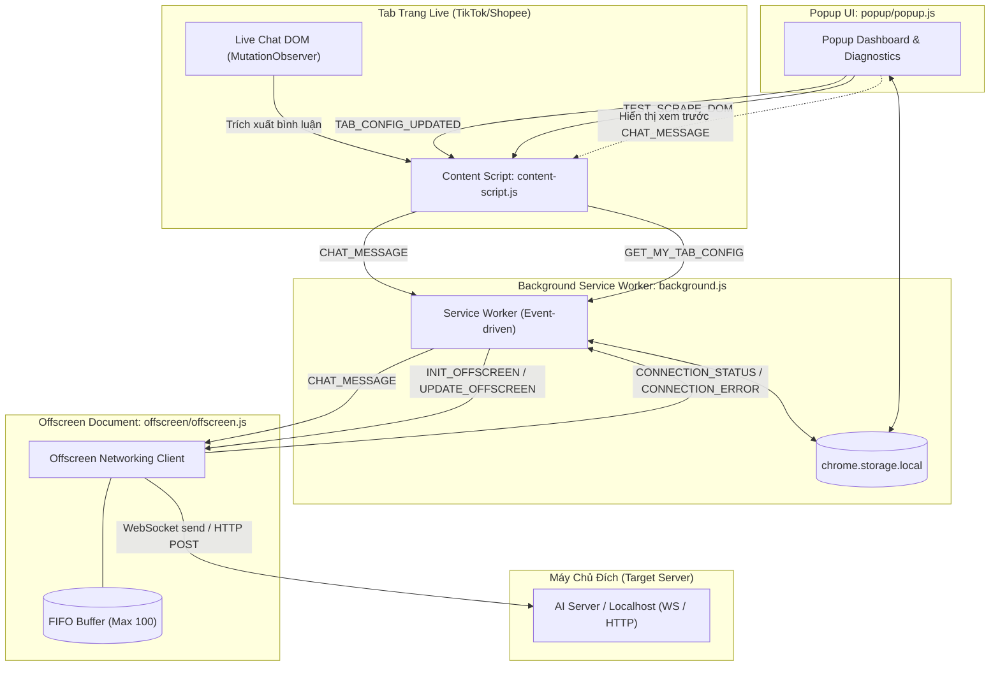

# Đặc Tả Kiến Trúc Tổng Thể (System Architecture Specification)

## Tổng Quan (Overview)
LIVE Relayer là tiện ích mở rộng trình duyệt (Chrome Extension) tuân thủ chuẩn **Manifest V3 (MV3)**, phục vụ việc tự động trích xuất các bình luận trực tiếp (live chat) từ các nền tảng phát sóng trực tiếp (TikTok Live, Shopee Live) và chuyển tiếp về một máy chủ cục bộ hoặc từ xa qua giao thức WebSocket hoặc HTTP POST.

Hệ thống được chia thành 4 phân hệ chính:
1. **Content Script Layer** (`content-script.js`): Chạy trực tiếp trong ngữ cảnh trang web livestream để theo dõi DOM và bắt bình luận.
2. **Background Service Worker Layer** (`background.js`): Điều phối vòng đời tiện ích, quản lý session đa tab và kiểm soát vòng đời của Offscreen Document.
3. **Offscreen Document Layer** (`offscreen/offscreen.html`, `offscreen/offscreen.js`): Duy trì kết nối mạng ổn định với máy chủ, quản lý hàng đợi bộ đệm (FIFO buffer) và truyền tin.
4. **Popup UI Layer** (`popup/popup.html`, `popup/popup.js`, `popup/popup.css`): Giao diện người dùng trên thanh công cụ để cấu hình kết nối, chọn bộ selector, theo dõi trạng thái và xem trước bình luận thời gian thực.

---

## Luồng Dữ Liệu và Thông Điệp Nội Bộ (Message Passing Architecture)

---

## Yêu Cầu Chức Năng (Requirements & Scenarios)

### Yêu Cầu 1: Khởi Tạo Môi Trường Manifest V3 và Dữ Liệu Ban Đầu
Hệ thống PHẢI khởi tạo các giá trị cấu hình mặc định trong `chrome.storage.local` khi cài đặt tiện ích mở rộng lần đầu.

#### Kịch Bản: Khởi tạo khi cài đặt tiện ích
* **GIVEN**: Tiện ích mở rộng được cài đặt lần đầu hoặc cập nhật (`chrome.runtime.onInstalled`).
* **WHEN**: Sự kiện `onInstalled` được kích hoạt.
* **THEN**: Service worker nạp tệp `selectors.json`, lưu `selector_presets`, `selectors` mặc định (`tiktok`), và `active_preset` vào `chrome.storage.local`.
* **AND**: Khởi tạo cấu hình kết nối mặc định (`host`: `"127.0.0.1"`, `port`: `"3003"`, `protocol`: `"http"`, `path`: `"/api/chat/tiktok-comment"`, `ai_reply_id`: `"default"`) nếu chưa tồn tại.
* **AND**: Khởi tạo cấu trúc `tab_sessions` rỗng (`{}`) nếu chưa tồn tại.

---

### Yêu Cầu 2: Quản Lý Vòng Đời Offscreen Document Theo Nhu Cầu
Vì Service Worker trong Manifest V3 bị ngắt kết nối định kỳ và không hỗ trợ trực tiếp DOM hoặc duy trì kết nối WebSocket bền bỉ, hệ thống PHẢI sử dụng `chrome.offscreen` document và CHỈ mở tài liệu này khi có ít nhất một tab đang kích hoạt chế độ giám sát (`monitoring_active`).

#### Kịch Bản: Tự động khởi tạo Offscreen Document khi có tab bật giám sát
* **GIVEN**: Không có tab nào đang kích hoạt cào dữ liệu và Offscreen Document chưa được mở.
* **WHEN**: Người dùng bật công tắc giám sát (`monitoring_active = true`) trên bất kỳ tab livestream hợp lệ nào.
* **THEN**: Background Service Worker phát hiện trạng thái thay đổi qua `chrome.storage.onChanged` và gọi `chrome.offscreen.createDocument`.
* **AND**: Thiết lập lý do mở tài liệu là `DOM_SCRAPING` và mục đích chuyển tiếp bình luận về máy chủ.

#### Kịch Bản: Tự động đóng Offscreen Document khi không còn tab nào hoạt động
* **GIVEN**: Offscreen Document đang chạy và có một hoặc nhiều tab đang giám sát.
* **WHEN**: Tất cả các tab đang giám sát bị tắt công tắc giám sát HOẶC các tab trình duyệt đó bị đóng.
* **THEN**: Background Service Worker kiểm tra thấy `isAnyTabMonitoring() === false`.
* **AND**: Gọi `chrome.offscreen.closeDocument()` để giải phóng tài nguyên hệ thống.

---

### Yêu Cầu 3: Đồng Bộ Cấu Hình Giữa Background và Offscreen Document
Hệ thống PHẢI đảm bảo Offscreen Document luôn nhận được cấu hình kết nối mới nhất ngay khi được nạp hoặc khi người dùng lưu thay đổi.

#### Kịch Bản: Đồng bộ cấu hình khi Offscreen khởi động
* **GIVEN**: Offscreen Document vừa được tải xong (`offscreen.html`).
* **WHEN**: `offscreen.js` gửi thông điệp `OFFSCREEN_LOADED` lên background.
* **THEN**: Background Service Worker phản hồi lại bằng thông điệp `INIT_OFFSCREEN` kèm theo `connectionSettings` và `monitoringActive`.
* **AND**: `offscreen.js` khởi tạo kết nối mạng tương ứng với giao thức đã chọn (`ws` hoặc `http`).

#### Kịch Bản: Cập nhật cấu hình tức thời khi người dùng lưu trên Popup
* **GIVEN**: Offscreen Document đang mở và đang hoạt động.
* **WHEN**: Người dùng thay đổi thông số kết nối và nhấn "Save Config" trên Popup UI.
* **THEN**: `chrome.storage.onChanged` bắt được sự kiện thay đổi `connection_settings`.
* **AND**: Background gửi thông điệp `UPDATE_OFFSCREEN` đến Offscreen Document để cập nhật thông số kết nối mà không cần tải lại tiện ích.
