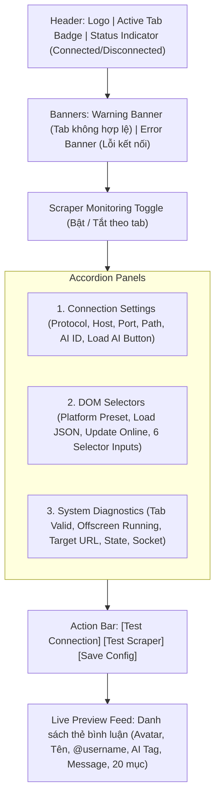

# Đặc Tả Giao Diện Điều Khiển Popup (Popup UI Specification)

## Purpose
Giao diện Popup (`popup/popup.html`, `popup/popup.js`, `popup/popup.css`) là trung tâm điều khiển trực tiếp dành cho người dùng trên thanh công cụ của trình duyệt Chrome, cung cấp khả năng nhận diện tab livestream, bật/tắt cào bình luận, cấu hình kết nối mạng, tải bot AI, chọn preset bộ chọn DOM, giám sát chẩn đoán hệ thống, kiểm thử kết nối và xem trước luồng bình luận trực tiếp thời gian thực.

---

## Kiến Trúc Giao Diện và Các Vùng Thành Phần

---

## Requirements

### Requirement: Tự Động Nhận Diện Tab Hoạt Động và Cảnh Báo Tính Hợp Lệ
Khi người dùng mở Popup, giao diện MUST truy vấn tab hiện tại và xác định xem URL có phải là trang web hợp lệ (`http://`, `https://`, `file://`) hay không.

#### Scenario: Mở Popup trên tab web hợp lệ
* **GIVEN**: Người dùng đang mở một tab có URL `https://www.tiktok.com/@streamer/live`.
* **WHEN**: Người dùng nhấp biểu tượng tiện ích để mở Popup.
* **THEN**: Huy hiệu tab hiển thị `Tab #<id> (tiktok.com)`.
* **AND**: Công tắc giám sát (`monitoringToggle`) được mở khóa cho phép thao tác.
* **AND**: Biểu ngữ cảnh báo `warning-banner` bị ẩn đi.

#### Scenario: Mở Popup trên tab hệ thống không hợp lệ
* **GIVEN**: Người dùng đang ở tab `chrome://extensions` hoặc `chrome://newtab`.
* **WHEN**: Người dùng mở Popup.
* **THEN**: Biểu ngữ cảnh báo hiển thị: `"Please navigate to a supported Live stream page to start monitoring."`.
* **AND**: Công tắc giám sát bị vô hiệu hóa (`disabled = true`) để ngăn thao tác lỗi.

---

### Requirement: Tải Danh Sách Bot AI Từ Máy Chủ Đích (Load AI)
Hệ thống MUST hỗ trợ lấy danh sách các phiên bản bot AI đang hoạt động từ máy chủ và hiển thị qua một giao diện Modal trực quan tích hợp sẵn trong Popup thay vì sử dụng các hộp thoại trình duyệt blocking (alert/prompt), đồng thời MUST sử dụng ngôn ngữ Tiếng Anh chuẩn thống nhất với toàn bộ giao diện.

#### Scenario: Lấy danh sách bot AI thành công
- **WHEN** Người dùng nhấn nút "Load AI" trên giao diện Popup
- **THEN** Hệ thống MUST gửi yêu cầu HTTP GET đến endpoint của máy chủ
- **AND** Hiển thị danh sách bot AI trong một Modal nội bộ với trạng thái [ACTIVE/INACTIVE]
- **AND** Khi người dùng nhấp chọn một bot, ID của bot đó MUST được điền vào ô "AI Auto-Reply ID" và đóng Modal

#### Scenario: Xử lý khi không có bot hoặc máy chủ mất kết nối
- **WHEN** Máy chủ trả về danh sách rỗng hoặc gặp lỗi kết nối
- **THEN** Hệ thống MUST hiển thị thông báo lỗi bằng Tiếng Anh trên banner thông báo của form mà không kích hoạt cửa sổ window.alert()

---

### Requirement: Kiểm Thử Kết Nối Mạng (Test Connection)
Người dùng MUST có khả năng kiểm tra xem máy chủ đích có thể tiếp cận được hay không trước khi bắt đầu livestream, với giao diện hiển thị phản hồi toàn chiều ngang ổn định, không làm xô lệch các trường nhập liệu và tự động mở panel cấu hình nếu đang đóng.

#### Scenario: Kiểm tra kết nối WebSocket
* **GIVEN**: Cấu hình đang chọn giao thức `ws`.
* **WHEN**: Người dùng nhấn nút `"Test Connection"` trên Action Bar.
* **THEN**: Popup kiểm tra panel `"Connection Settings"`, nếu đang đóng thì MUST tự động mở panel này ra để người dùng quan sát kết quả.
* **AND**: Popup tạo một kết nối thử nghiệm `new WebSocket(url)` với thời gian timeout là 5000ms.
* **AND**: Phần tử thông báo kết quả kiểm thử MUST hiển thị dạng khối toàn chiều ngang (block width 100%), không nằm chung hàng flexbox với các trường dữ liệu khác.
* **AND**: Nếu bắt được sự kiện `onopen`, hiển thị thông báo thành công màu xanh lá: `"Connection Success! WebSocket server is running..."` và tự động đóng socket thử nghiệm.
* **AND**: Nếu xảy ra lỗi hoặc quá 5 giây không phản hồi, hiển thị thông báo lỗi màu đỏ rõ ràng với thông tin lỗi được bọc ngắt dòng an toàn.

#### Scenario: Kiểm tra kết nối HTTP POST
* **GIVEN**: Cấu hình đang chọn giao thức `http`.
* **WHEN**: Người dùng nhấn nút `"Test Connection"` trên Action Bar.
* **THEN**: Popup kiểm tra panel `"Connection Settings"`, nếu đang đóng thì MUST tự động mở panel này ra.
* **AND**: Popup gửi một yêu cầu `fetch(url, { method: "GET", mode: "cors" })` với thời gian timeout 5000ms.
* **AND**: Phần tử thông báo hiển thị đầy đủ trạng thái đang kiểm tra (`Testing connection to...`) và kết quả phản hồi mà không làm biến dạng các ô nhập `AI Auto-Reply ID` hay `Filter Duplicate Comments`.
* **AND**: Nếu nhận được mã trạng thái HTTP, hiển thị thông báo thành công.

### Requirement: Xem Trước Luồng Bình Luận Trực Tiếp (Live Comments Preview)
Popup MUST hiển thị danh sách cuộn trực quan các bình luận mới nhất nhận được từ Content Script của tab hiện tại, tối đa 20 phần tử.

#### Scenario: Nhận bình luận mới khi Popup đang mở
* **GIVEN**: Tab hiện tại đang bật giám sát và Popup đang mở.
* **WHEN**: Content Script gửi thông điệp `CHAT_MESSAGE`.
* **THEN**: Popup nhận được thông điệp và tạo một thẻ bình luận mới (`comment-card`) bao gồm:
  * Ảnh đại diện (hoặc icon SVG dự phòng nếu không có ảnh hoặc ảnh lỗi tải).
  * Tên hiển thị (`nickname`).
  * Username (`@username`).
  * Huy hiệu AI Persona (`AI: <ai_reply_id>`).
  * Nội dung câu hỏi/bình luận (`message`).
* **AND**: Thêm thẻ vào cuối danh sách và tự động cuộn xuống dưới cùng.
* **AND**: Nếu số lượng thẻ vượt quá 20, tự động xóa thẻ cũ nhất ở đầu danh sách.
* **AND**: Cập nhật bộ đếm hiển thị: `X / 20`.
 
---

### Requirement: Chuẩn Hóa Toàn Diện Ngôn Ngữ Giao Diện Sang Tiếng Anh
Toàn bộ nhãn, placeholder, tooltip và thông báo phản hồi trên giao diện Popup MUST sử dụng Tiếng Anh thống nhất.
 
#### Scenario: Người dùng quan sát các trường giao diện
- **WHEN** Người dùng mở Popup Dashboard
- **THEN** Tất cả các nhãn, placeholder gợi ý, tiêu đề nút bấm và thông báo phản hồi MUST hiển thị bằng Tiếng Anh

### Requirement: Điều Khiển Cấu Hình Chống Trùng Lặp Bình Luận Trên Popup
Giao diện Popup MUST cung cấp các trường điều khiển trực quan cho phép người dùng bật/tắt tính năng chống trùng lặp bình luận và điều chỉnh thời gian cửa sổ cooldown, với tất cả nhãn hiển thị bằng Tiếng Anh chuẩn.

#### Scenario: Hiển thị và thay đổi cấu hình chống trùng trên Popup
* **GIVEN**: Người dùng mở bảng điều khiển Popup trên một tab livestream hợp lệ.
* **WHEN**: Người dùng xem phần thiết lập trong panel cấu hình.
* **THEN**: Giao diện hiển thị checkbox "Filter Duplicate Comments" (mặc định được tích chọn) và ô nhập "Duplicate Cooldown (seconds)" (mặc định giá trị là 30, nhận giá trị số từ 1 đến 300).
* **AND**: Khi người dùng nhấn nút "Save Config", các giá trị này được lưu vào `tab_sessions[currentTabId]` và `connection_settings`.
* **AND**: Popup gửi thông điệp `TAB_CONFIG_UPDATED` ngay lập tức tới Content Script của tab hiện tại để áp dụng thay đổi trong thời gian thực.

---

### Requirement: Kiểm Thử Bộ Chọn Cào DOM và Ổn Định Bố Cục Popup
Giao diện Popup MUST duy trì bố cục cố định và tự động mở accordion panel tương ứng khi người dùng thực hiện các thao tác kiểm thử từ Action Bar.

#### Scenario: Nhấn Test Scraper khi panel DOM Selectors đang đóng
* **GIVEN**: Người dùng đang mở Popup và panel `"DOM Selectors"` đang thu gọn.
* **WHEN**: Người dùng nhấn nút `"Test Scraper"` trên Action Bar.
* **THEN**: Hệ thống MUST tự động mở rộng panel `"DOM Selectors"` để hiển thị tiến trình quét DOM và kết quả kiểm thử.
* **AND**: Kết quả kiểm thử bộ chọn MUST hiển thị dưới dạng khối thông báo độc lập, không gây tràn khung ngang.

#### Scenario: Xuất hiện thanh cuộn dọc không gây xô lệch chiều ngang
* **GIVEN**: Người dùng mở các panel hoặc danh sách bình luận nhiều hơn chiều cao tối đa của cửa sổ Popup.
* **WHEN**: Nội dung kích hoạt thanh cuộn dọc của trình duyệt.
* **THEN**: Bố cục Popup MUST sử dụng cơ chế giữ chỗ cuộn ổn định (`scrollbar-gutter: stable`), ngăn ngừa hiện tượng giật giật (layout jitter/shift) và không làm co hẹp đột ngột các nút bấm hoặc trường dữ liệu.
