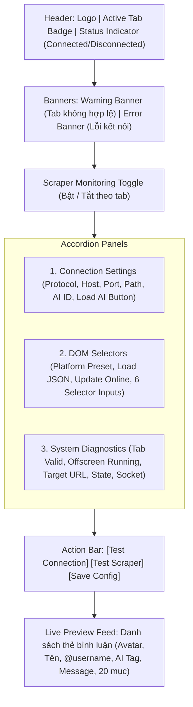

# Đặc Tả Giao Diện Điều Khiển Popup (Popup UI Specification)

## Tổng Quan (Overview)
Giao diện Popup (`popup/popup.html`, `popup/popup.js`, `popup/popup.css`) là trung tâm điều khiển trực tiếp dành cho người dùng trên thanh công cụ của trình duyệt Chrome. Giao diện cung cấp khả năng:
1. Nhận biết và hiển thị ngữ cảnh tab livestream đang mở.
2. Bật/tắt chế độ cào bình luận tức thì cho tab hiện tại.
3. Cấu hình địa chỉ mạng và định danh bot AI tiếp nhận.
4. Tùy biến bộ chọn CSS DOM theo từng nền tảng hoặc tệp JSON.
5. Giám sát tình trạng kỹ thuật thời gian thực qua bảng chẩn đoán hệ thống (System Diagnostics).
6. Kiểm thử kết nối mạng và kiểm thử cào DOM với phản hồi trực quan.
7. Theo dõi luồng bình luận đang được cào theo thời gian thực (tối đa 20 bình luận gần nhất).

---

## Kiến Trúc Giao Diện và Các Vùng Thành Phần

---

## Yêu Cầu Chức Năng (Requirements & Scenarios)

### Yêu Cầu 1: Tự Động Nhận Diện Tab Hoạt Động và Cảnh Báo Tính Hợp Lệ
Khi người dùng mở Popup, giao diện PHẢI truy vấn tab hiện tại và xác định xem URL có phải là trang web hợp lệ (`http://`, `https://`, `file://`) hay không.

#### Kịch Bản: Mở Popup trên tab web hợp lệ
* **GIVEN**: Người dùng đang mở một tab có URL `https://www.tiktok.com/@streamer/live`.
* **WHEN**: Người dùng nhấp biểu tượng tiện ích để mở Popup.
* **THEN**: Huy hiệu tab hiển thị `Tab #<id> (tiktok.com)`.
* **AND**: Công tắc giám sát (`monitoringToggle`) được mở khóa cho phép thao tác.
* **AND**: Biểu ngữ cảnh báo `warning-banner` bị ẩn đi.

#### Kịch Bản: Mở Popup trên tab hệ thống không hợp lệ
* **GIVEN**: Người dùng đang ở tab `chrome://extensions` hoặc `chrome://newtab`.
* **WHEN**: Người dùng mở Popup.
* **THEN**: Biểu ngữ cảnh báo hiển thị: `"Please navigate to a supported Live stream page to start monitoring."`.
* **AND**: Công tắc giám sát bị vô hiệu hóa (`disabled = true`) để ngăn thao tác lỗi.

---

### Yêu Cầu 2: Tải Danh Sách Bot AI Từ Máy Chủ Đích (Load AI)
Hệ thống PHẢI hỗ trợ lấy danh sách các phiên bản bot AI đang hoạt động từ máy chủ để người dùng chọn nhanh mà không cần nhập thủ công.

#### Kịch Bản: Lấy danh sách bot AI thành công
* **GIVEN**: Máy chủ đang chạy và cung cấp endpoint `GET /api/auto-reply/public`.
* **WHEN**: Người dùng bấm nút `"🔄 Load AI"`.
* **THEN**: Popup gửi yêu cầu HTTP GET đến `http://${host}:${port}/api/auto-reply/public`.
* **AND**: Trích xuất mảng `instances` và hiển thị hộp thoại prompt liệt kê danh sách bot kèm trạng thái `[BẬT/TẮT]`.
* **AND**: Khi người dùng chọn một ID bot, giá trị này tự động điền vào ô `AI Auto-Reply ID`.

---

### Yêu Cầu 3: Kiểm Thử Kết Nối Mạng (Test Connection)
Người dùng PHẢI có khả năng kiểm tra xem máy chủ đích có thể tiếp cận được hay không trước khi bắt đầu livestream.

#### Kịch Bản: Kiểm tra kết nối WebSocket
* **GIVEN**: Cấu hình đang chọn giao thức `ws`.
* **WHEN**: Người dùng nhấn nút `"Test Connection"`.
* **THEN**: Popup tạo một kết nối thử nghiệm `new WebSocket(url)` với thời gian timeout là 5000ms.
* **AND**: Nếu bắt được sự kiện `onopen`, hiển thị thông báo thành công màu xanh lá: `"Connection Success! WebSocket server is running..."` và tự động đóng socket thử nghiệm.
* **AND**: Nếu xảy ra lỗi hoặc quá 5 giây không phản hồi, hiển thị thông báo lỗi màu đỏ.

#### Kịch Bản: Kiểm tra kết nối HTTP POST
* **GIVEN**: Cấu hình đang chọn giao thức `http`.
* **WHEN**: Người dùng nhấn nút `"Test Connection"`.
* **THEN**: Popup gửi một yêu cầu `fetch(url, { method: "GET", mode: "cors" })` với thời gian timeout 5000ms.
* **AND**: Nếu nhận được mã trạng thái HTTP, hiển thị thông báo thành công.

---

### Yêu Cầu 4: Xem Trước Luồng Bình Luận Trực Tiếp (Live Comments Preview)
Popup PHẢI hiển thị danh sách cuộn trực quan các bình luận mới nhất nhận được từ Content Script của tab hiện tại, tối đa 20 phần tử.

#### Kịch Bản: Nhận bình luận mới khi Popup đang mở
* **GIVEN**: Tab hiện tại đang bật giám sát và Popup đang mở.
* **WHEN**: Content Script gửi thông điệp `CHAT_MESSAGE`.
* **THEN**: Popup nhận được thông điệp và tạo một thẻ bình luận mới (`comment-card`) bao gồm:
  * Ảnh đại diện (hoặc icon SVG dự phòng nếu không có ảnh hoặc ảnh lỗi tải).
  * Tên hiển thị (`nickname`).
  * Username (`@username`).
  * Huy hiệu AI Persona (`AI: <ai_reply_id>`).
  * Nội dung câu hỏi/bình luận (`message`).
* **AND**: Thêm thẻ vào cuối danh sách và tự động cuộn xuống dưới cùng.
* **AND**: Nếu số lượng thẻ vượt quá 20, tự động xóa thẻ cũ nhất ở đầu danh sách.
* **AND**: Cập nhật bộ đếm hiển thị: `X / 20`.
