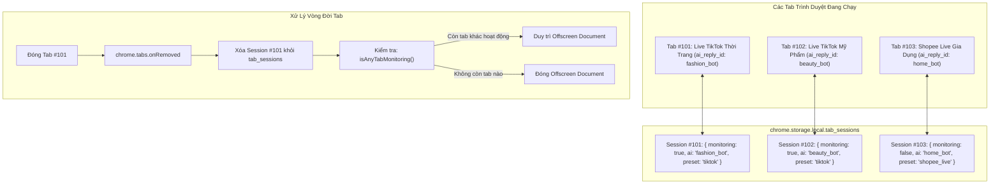

# Đặc Tả Quản Lý Phiên Đa Tab (Multi-Tab Session Isolation Specification)

## Tổng Quan (Overview)
Hệ thống hỗ trợ giám sát đồng thời nhiều phòng livestream trên nhiều tab trình duyệt khác nhau mà không bị xung đột cấu hình. Mỗi tab trình duyệt được định danh bởi `tabId` và có một bản ghi cấu hình phiên làm việc độc lập lưu trong `tab_sessions` thuộc `chrome.storage.local`. Điều này cho phép người dùng gắn các cấu hình kịch bản AI (`ai_reply_id`) và bộ chọn (selector presets) riêng biệt cho từng phòng live stream.

---

## Kiến Trúc Quản Lý Phiên Làm Việc

---

## Yêu Cầu Chức Năng (Requirements & Scenarios)

### Yêu Cầu 1: Cô Lập Cấu Hình Theo Tab (Tab Isolation)
Mỗi tab trình duyệt mở trang livestream PHẢI có cấu hình độc lập bao gồm trạng thái giám sát (`monitoring_active`), định danh bot AI (`ai_reply_id`), cấu hình kết nối, và bộ chọn DOM.

#### Kịch Bản: Cấu hình hai tab livestream với hai bot AI khác nhau
* **GIVEN**: Tab A đang mở một phòng live TikTok bán quần áo, Tab B đang mở một phòng live TikTok bán mỹ phẩm.
* **WHEN**: Người dùng mở Popup tại Tab A và đặt `ai_reply_id = "bot_fashion"`, sau đó mở Popup tại Tab B và đặt `ai_reply_id = "bot_cosmetics"`.
* **THEN**: Dữ liệu lưu trong `chrome.storage.local` phân tách rõ ràng:
  * `tab_sessions[TabA.id].ai_reply_id === "bot_fashion"`
  * `tab_sessions[TabB.id].ai_reply_id === "bot_cosmetics"`
* **AND**: Khi Tab A có bình luận mới, gói tin gửi sang server mang `ai_reply_id: "bot_fashion"`.
* **AND**: Khi Tab B có bình luận mới, gói tin gửi sang server mang `ai_reply_id: "bot_cosmetics"`.

---

### Yêu Cầu 2: Tự Động Thu Dọn Phiên Khi Đóng Tab (Tab Cleanup)
Hệ thống PHẢI tự động giải phóng bản ghi phiên làm việc trong `tab_sessions` khi tab tương ứng bị đóng trên trình duyệt.

#### Kịch Bản: Người dùng đóng tab livestream
* **GIVEN**: Tab #101 đang có phiên làm việc lưu trong `tab_sessions`.
* **WHEN**: Người dùng đóng Tab #101 (`chrome.tabs.onRemoved` kích hoạt với tham số `tabId = 101`).
* **THEN**: Background Service Worker thực hiện xóa thuộc tính `sessions[101]` khỏi `tab_sessions` trong `chrome.storage.local`.
* **AND**: Gọi `isAnyTabMonitoring()` để kiểm tra xem còn tab nào khác đang cào dữ liệu hay không.
* **AND**: Nếu không còn tab nào khác đang bật giám sát, thực hiện tắt Offscreen Document.

---

### Yêu Cầu 3: Tự Động Nạp Cấu Hình Khi Content Script Khởi Chạy
Khi trang livestream được tải hoặc tải lại, Content Script PHẢI yêu cầu cấu hình tương ứng với tab của nó từ Service Worker.

#### Kịch Bản: Content Script gửi yêu cầu nạp cấu hình phiên
* **GIVEN**: Trang web livestream vừa được tải xong, Content Script được tiêm vào trang.
* **WHEN**: Hàm `initTabConfig()` trong `content-script.js` gửi thông điệp `GET_MY_TAB_CONFIG` lên background.
* **THEN**: Background xác định `tabId` từ `sender.tab.id`.
* **AND**: Trả về đúng cấu hình của tab đó từ `tab_sessions[tabId]` (hoặc cấu hình mặc định nếu tab chưa từng được lưu cấu hình riêng).
* **AND**: Content Script áp dụng ngay trạng thái giám sát và bộ chọn mà không cần người dùng thao tác lại.
